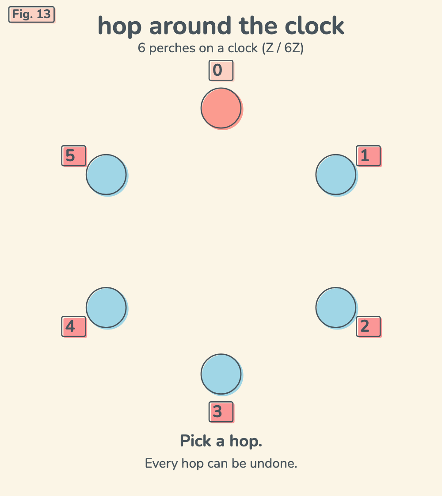

# The Cyclic Group

Fig. 13 in my "math facts that live in my head" series. Clock addition on the cyclic group Z / 6Z: hops you can always undo.

Six perches, 0 to 5, sit on a clock. Hop +1 and you visit every perch. Hop +2 and you are locked in a triangle that never touches 1, 3 or 5. Hop +3 and you swing between 0 and 3. Every hop has another that brings you back home to 0.

Open it: https://ibeez.github.io/cyclic-group/



[Watch one loop (MP4)](exports/cyclic-group-loop.mp4): 12 seconds with sound, H.264 + AAC, 1000 x 1120 at 30 fps.

## Run It Locally

```bash
cd ~/Documents/Notes/03-Math-Facts+Games && python3 -m http.server 8792 --bind 127.0.0.1
```

Then open http://127.0.0.1:8792/cyclic-group/.

`video.html` is the build source for the video (it needs the vault's `design/` tools, so it only runs inside the vault).
